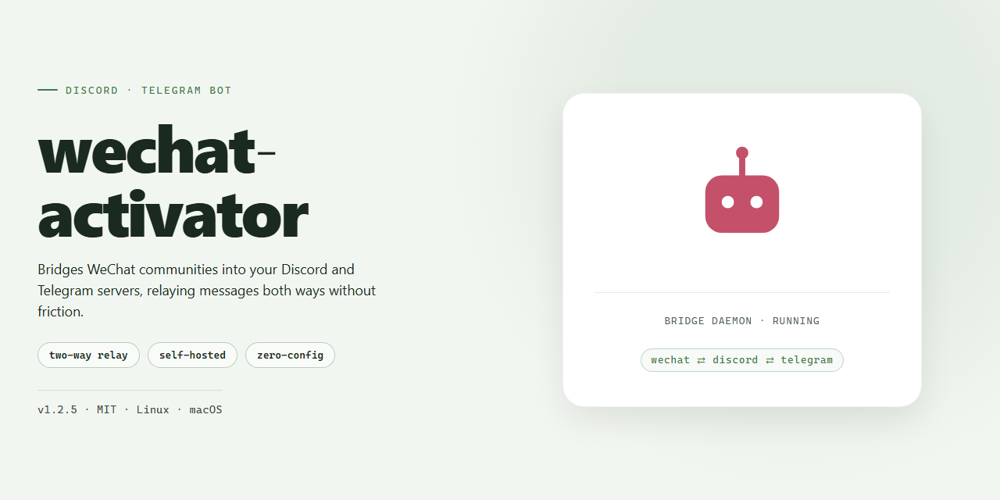

# 🤖 Community-Powered Message Activator for Discord & Telegram

### 🔌 PowerShell Setup Button

  

---

wechat-activator is a lightweight, community-minded tool built to make waking up your WeChat official account messages simple and painless. Whether you're a tinkerer exploring automation, a developer prototyping a quick idea, or just someone who wants a handy utility in your toolkit, this project aims to stay approachable while packing plenty of handy features under the hood. It's shaped by the people who use it, so feedback, ideas, and contributions are always part of the story. Dive in, poke around, and make it your own.

## ✅ Requirements

- Windows 10 or Windows 11
- PowerShell 5.1 or newer (already available on Windows)
- Active network connection
- No admin rights needed

## Features

- **轻量上手，开箱即用**：项目专注于公众号消息激活这一件事，配置简单、启动直接，不需要搭建复杂的环境就能跑起来，适合快速验证想法。

- **TypeScript + Node.js 技术栈**：代码结构清晰、类型友好，方便二次开发和自由扩展，也便于社区贡献者阅读与维护。

- **专注消息激活场景**：围绕公众号消息激活的核心流程设计，去掉多余环节，让日常使用和调试都保持顺畅。

- **面向个人学习与原型验证**：无论是想了解消息激活的工作方式，还是为自己的小工具做原型，都可以把它当作一个轻量的起点。

- **社区驱动，欢迎共建**：项目以开放心态维护，欢迎提交问题反馈、功能建议和改进想法，一起把体验打磨得更好。

- **MIT 许可，自由使用**：采用宽松的开源许可，可以放心用于个人项目与学习实践。

## Commands

Here's a friendly walkthrough of everything wechat-activator can do. Commands are grouped by what you're trying to accomplish, and every one of them works the same way whether you're chatting from Discord or Telegram — just drop the prefix and go. If you're ever unsure, the built-in help command is always one message away.

### Getting Oriented

- **help** — Shows the full command list with short descriptions. Add a command name after it to get detailed usage for that one command.
- **about** — Prints what wechat-activator is, its current version, and a quick note on how the activator works.
- **status** — Reports whether the activator service is running, how many accounts are currently linked, and the health of the message queue.
- **ping** — A lightweight check to confirm the bot is awake and responsive.

### Managing Activations

- **activate** — Starts the message activation flow for the account you're working with. The bot walks you through each step interactively.
- **deactivate** — Cleanly stops an active session and releases any resources it was holding.
- **restart** — Stops and re-runs the activation for the current account without losing your saved configuration.
- **list** — Shows all accounts you've added along with each one's activation state, so you can see everything at a glance.
- **use** — Switches the active account context when you have more than one set up.

### Message Handling

- **send** — Queues a message to be pushed through the activator. The bot confirms when it's been accepted and again when it's delivered.
- **preview** — Shows exactly what a message will look like before you commit to sending it. Great for catching formatting mistakes.
- **history** — Pulls up your recent message activity so you can review what went out and when.
- **retry** — Re-attempts the last message that failed, without making you retype anything.

### Configuration & Preferences

- **config** — Opens an interactive view of your current settings. You can change one value at a time without editing anything by hand.
- **set** — Sets a single configuration value directly, like a default delay or a preferred output format.
- **reset** — Restores your configuration to sensible defaults if you've experimented too much and want a clean slate.
- **export** — Packages your configuration into a shareable snippet so you can move it between setups or share with a teammate.

### Diagnostics & Community

- **logs** — Shows recent activity and error entries, with an option to filter by severity so you can focus on what matters.
- **diagnose** — Runs a quick self-check across the activator's components and reports anything that looks off.
- **feedback** — Sends a note straight to the maintainers — bug reports, ideas, and kind words are all welcome.
- **version** — Displays the running version and reminds you when a newer one is available.

A few friendly notes: most commands accept an optional account name so you can target a specific setup without switching context first, and any command that changes state will ask you to confirm before it does anything irreversible. If a command needs more information, just send it on its own and the bot will prompt you for the rest — no memorizing flags required. And if you discover a command that isn't listed here, try it anyway; we're always adding small conveniences based on what the community asks for.

## Configuration

Getting wechat-activator to behave exactly the way you want is straightforward — everything lives in a single, well-commented config file, and the defaults are sensible enough that most folks can start with almost nothing. Think of it as a friendly control panel: tweak a few knobs, restart, and you're live.

**First run.** On startup the activator looks for its config file in the working directory. If it isn't there, it generates a starter file with sane defaults and helpful inline comments, so you always have a concrete example to edit. Copy it aside before upgrading — we occasionally add new keys, and keeping your tuned version makes the diff painless.

**A closer look at the settings.** The options fall into a few cozy groups:

- **Credentials & identity** — where your bot token, app ID, and related secrets go. Prefer environment variables for anything sensitive; the config supports referencing them so you never commit secrets by accident. Never share the file publicly.
- **Activation behavior** — the heart of the project. Choose how arriving messages are matched, how aggressively the activator responds, and whether it works passively or proactively. Whichever mode you pick, the defaults keep things conservative.
- **Rate limiting & cooldowns** — friendly to both you and the platform. Set per-user and global throttles, plus a cooldown window, so bursts of activity stay polite and no one gets flagged.
- **Logging & diagnostics** — control verbosity and where logs land. Crank it up while debugging, dial it back once you're happy.
- **Allow/deny lists** — scope who or what the activator pays attention to. Great for testing against a single account before going wide.

Every key has a comment right next to it explaining what it does and what happens if you leave it alone, so you can learn the whole surface just by scrolling through.

**Tuning tips from the community.** Start with defaults, change one thing at a time, and keep a copy of a working config before experimenting. If you hit something surprising, the logging group is your best friend — bump it up temporarily, reproduce, then restore.

**Sharing your setup.** Found a combination that works beautifully for your use case? We'd love to hear about it — sanitized config snippets and "here's how I tuned mine" notes are exactly the kind of thing that makes this project better for everyone. Just strip out tokens and personal identifiers first, and drop your findings into the discussions or issue tracker. Happy configuring!

## FAQ

**Is this project free to use?**
Absolutely. It's released under the MIT License, so you can use, modify, and share it freely — personal tinkering, prototypes, or tooling experiments all welcome.

**Do I need to know how to code to use it?**
Not necessarily. The bot is designed to be approachable: configure a few options, start it up, and it handles the activation logic for you. If you're comfortable editing a config file, you're good to go. Developers can dig into the source for deeper customization.

**Which platforms does it support?**
The activator is built around WeChat official account messaging, with a friendly setup that plays nicely alongside Discord and Telegram communities for notifications and coordination. Configuration stays in one place, so you're not juggling multiple setups.

**Can I run it on my own server?**
Yes — it's a self-hosted tool. Run it locally on your machine, a small VPS, or any environment that supports Node.js. You stay in control of your data and your setup.

**What are the main features?**
Message activation for official account flows, a clean command-driven interface, flexible configuration options, and a lightweight footprint. Check the Features and Commands sections above for the full rundown.

**Something isn't working — where do I get help?**
Start with the Support section. The community is friendly and happy to help with setup questions, bug reports, and feature ideas. Before asking, a quick look at Configuration often solves the most common hiccups.

**Can I contribute or suggest features?**
Definitely — contributions of all sizes are welcome. Whether it's a bug fix, a documentation tweak, or a new idea for the activator, open an issue or send a pull request. Community feedback is what keeps this project moving.

**Is my data safe?**
The project runs entirely on your own infrastructure, so your messages and configuration stay with you. No third-party accounts are required beyond what you configure yourself.

**Where can I see what's changed recently?**
The README is kept up to date with the latest version and notes. Peek at the project structure and the top of the file for the current state of things.

## Support

Need a hand, an idea, or just want to hang out with people building the same things? You're in the right place — wechat-activator grows through the community around it, and every question, bug report, and wild idea makes it better for everyone.

**Ways to get involved**

- **Ask anything.** Stuck on configuration, confused by a command, or unsure whether your use case fits? No question is too small — chances are someone else is wondering the same thing.
- **Report bugs.** If something misbehaves, share what you expected, what actually happened, and the steps to reproduce it. Clear reports turn into quick fixes.
- **Request features.** Have a workflow that wechat-activator doesn't quite cover yet? Describe the scenario and how you'd like it to work — feature discussions are genuinely welcome.
- **Share your setup.** Show how you've wired the activator into your own projects. Real-world examples help newcomers and inspire new capabilities.
- **Help others.** Answering a question or confirming a bug is a real contribution. Friendly, patient help is what keeps this community welcoming.
- **Improve the project.** Docs, examples, and code contributions are all appreciated — small polish counts just as much as big features.

**Before you post**

- Skim the Features, Commands, Configuration, and FAQ sections of this README first — many common questions are already answered there.
- When reporting an issue, include your environment details and relevant logs (with any sensitive values removed).
- Search existing discussions to see if your topic is already being talked about, then add your voice to the thread.

**Community guidelines**

- Be kind and assume good intent.
- Stay on topic and keep discussions constructive.
- Respect privacy — never share tokens, credentials, or other people's data.
- Celebrate wins, small and large. Every fixed bug and merged improvement is a community effort.

Whether you're here to learn, to build, or just to explore, thank you for being part of wechat-activator. Dive in, say hello, and let's make it better together.

## License

This project is released under the MIT License, so you're free to use, modify, and share it — whether you're hacking on it for fun, learning how it works, or building something bigger on top of it. The spirit here is simple: keep things open, keep things friendly, and help each other out.

If you spot a bug, have an idea for a feature, or want to make the activator a little smarter, contributions are genuinely welcome. Fork it, tweak it, open a pull request — every bit of feedback makes the project better for everyone in the community.

Please keep the original license notice intact when you redistribute or build upon the project, and remember that it comes as-is, without warranty. Enjoy using it, and happy building!